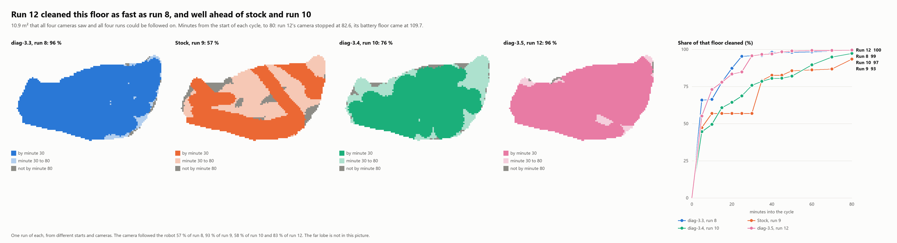
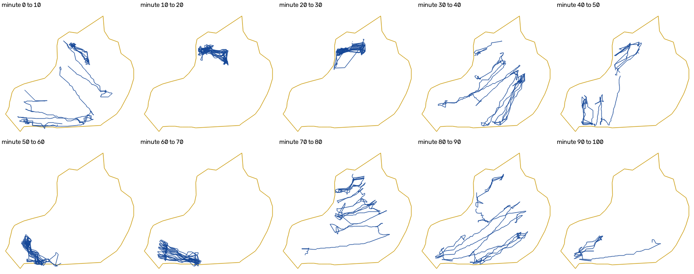
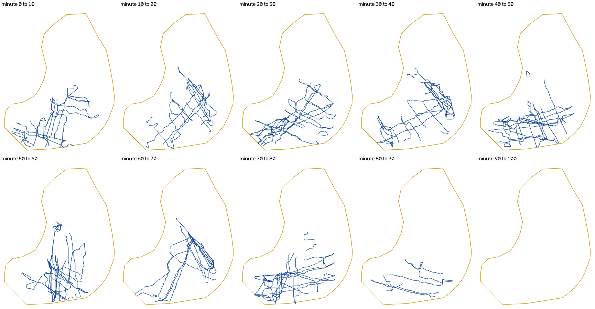

# SEAUTO Crab: optimized cleaning for a pool robot

Reverse engineering of the SEAUTO Crab robotic pool vacuum, an add-on that changes how it cleans the floor, and a video
method that measures the result.

**Firmware:** diag-3.5 is on the [Releases](../../releases) page. It has run a full cycle in the water, started from the
robot's button with no PC. This repository holds the desktop tools, the test scripts and the measurements. The
firmware's source is not published yet.

## The result so far



Five runs were filmed in the same pool: stock once, and the optimized program four times across three builds. They are
compared only on floor that every camera saw and every run could be followed on.

| Share of the same floor cleaned | Minute 10 | Minute 30 | Minute 45 |
|---|---|---|---|
| Stock, run 9 | 57.5 % | 57.5 % | 82.6 % |
| diag-3.3, run 8 | 66.6 % | 96.0 % | 98.2 % |
| diag-3.4, run 10 | 50.3 % | 76.8 % | 81.6 % |
| diag-3.4, run 11 | 76.9 % | 92.8 % | 97.0 % |
| diag-3.5, run 12 | 73.6 % | 96.2 % | 98.8 % |

That floor is 10.7 m². At minute 80, on the 10.9 m² the four long runs share, diag-3.5 had cleaned 99.5 % and stock
93.4 %. diag-3.5 ran 109.7 minutes to its battery floor, the longest run yet.

**Before:** stock spent 40 of its 93 minutes on two small strips, gaining only 1.3 m² of new floor.



**After:** diag-3.5 kept moving across the floor the camera sees. The far lobe, at the top, is hidden from this camera
by the sky's reflection, and the camera stopped at minute 82.6.



**Read these numbers with care:**

- This is one run of each build, in one pool, from different starting points and camera positions.
- The optimized runs differ among themselves, 77 to 96 % at minute 30, and three runs of the same pattern cannot say why.
- The far lobe of the pool is not compared, because no camera position so far could see it well.
- Coverage assumes a 40 cm brush, which has not been measured.

The [five-run analysis](analysis/optimized-runs/analysis.md) has the tables, the checks and the battery floor change.
The [stock against optimized analysis](analysis/stock-vs-optimized/analysis.md) has the first comparison in detail,
with five findings.

## The robot

The Crab is a battery robot with an Artery AT32 Cortex-M4, 128 KB of flash and 32 KB of RAM. It has a gyro and
accelerometer, one forward sonar, an in-water sensor and battery sensing. It has no wheel encoders and no position
sensor, so it can only estimate where it is from heading, drive and time.

The stock Floor program runs lanes on a timer. At a wall it backs off, shifts sideways for 1.4 s and makes a 166° U-turn,
which skews each lane by 14°. It has no memory of where it has been.

## How this was done

### 1. Read the firmware without opening the robot

Opening the robot is very hard, so everything had to work over Bluetooth. The vendor's Android app caches the update images
it downloads on the phone, where they can be read without root. The app also shows the Bluetooth protocol: Modbus RTU over
a serial-style BLE service, with a list of registers.

The images were then analysed offline. Capstone disassembled them. Unicorn ran the firmware's own startup code to recover
the register table, which is stored compressed. A small lifter turned the navigation code into readable pseudo-code, which
gave the stock cleaning program step by step.

### 2. Find the way in

The update path turned out to be open:

1. The app sends the F12 key sequence as a normal write, and the firmware resets into its bootloader.
2. The bootloader answers with `C`, the XMODEM start signal.
3. The image goes over in XMODEM-1K blocks, split into 23-byte BLE writes.

There is no signature and no whole-image checksum. Each block has its own CRC, and the bootloader only checks that the
image's initial stack pointer looks valid. So a modified image is accepted, and it can be replaced later over the same path.

### 3. Add code instead of rewriting

A full rewrite was never realistic, because it would have to rebuild the motor control and the safety behaviour with no
specification. So the vendor image stays as it is, and a small add-on is placed next to it:

- The add-on is C, compiled for this chip with no libraries. It sits in free flash after the vendor image, with its own RAM
  above the vendor's.
- Five vendor call instructions are redirected to the add-on, and so is the HardFault vector. Not one other byte of vendor
  code changes.
- Each redirected call still runs the vendor function it replaced, so the stock program keeps running underneath.

| Vendor call that was redirected | What the add-on does there |
|---|---|
| Modbus receive poll | Runs the vendor poll, then takes only its own private function codes. Stock frames pass through untouched |
| Loading saved state at boot | Runs the vendor load, then sets the "stay in update mode" flag as a safety net |
| Watchdog feed, idle loop | Feeds the watchdog, then clears that flag after 2000 passes. Runs the recorder, battery floor and long-press power-off |
| Watchdog feed, cleaning loop | The same, because the firmware has a second main loop during a cycle |
| Navigation step | Wraps the vendor's navigation with the optional controller and the map |
| HardFault vector | Keeps a crash trace in RAM, sets the flag and resets |

### 4. Override behaviour by editing what the vendor code reads

The vendor code keeps its decisions in RAM variables: the cleaning step, the target heading, the base speed, the
battery-empty latch. The add-on runs right next to that code, so it can change a feature by writing the same variables the
vendor code would. It does not need to replace the motor driver or the safety logic.

This is how one navigation pass works:

1. If the optimized mode is off for the current cleaning mode, call the vendor step and return. The robot is stock.
2. Otherwise call the vendor step first. It still does its own wall, tilt, recovery and battery handling.
3. Look at the result. The add-on steps aside for this pass if the robot is out of the water, tilted, in a wall phase,
   recovering, shutting down, faulted, out of battery, or past a turn timeout. Its private timers freeze while it waits.
4. If it is safe, ask the lane controller for a speed and a heading.
5. With interrupts off, check the safety state once more, and then write those commands over the vendor's.

The controller's own state lives in the add-on's RAM and never in the vendor's step variable. So switching the mode off during
a run hands the robot back to the stock program cleanly.

The features overridden this way:

| Feature | Stock | Override | Still the vendor's |
|---|---|---|---|
| Floor pattern | Timed shifts, 166° U-turns, no memory | Parallel lanes held by the gyro. The sonar checks each shift. A side ends on two blocked shifts, three short lanes, four lanes that add almost no new floor, 12 m of shifts, or no headway. A new sweep turns through eight headings and starts toward the least visited floor | Motor control, tilt and bump detection, wall handling, recovery, cycle timer |
| Stuck detection | 16 windows of stillness | 3 windows, about 33 s, and the sonar must also show no progress. With no echo the stock rule applies | The recovery moves themselves |
| Battery floor | Runs down to its own empty level | Default 20 %. Once the reading has stayed at or below the set level for a minute, the add-on sets the vendor's battery-empty latch | All end-of-battery behaviour |
| Stop after the battery floor | Drives to a wall, then stops at a close echo, a steep tilt, a collision or 200 s | Also stops when a near echo holds still for 3 s, and at 90 s at the latest | The motor stop itself |
| Power off | Can be blocked after a lift out of the water mid-cycle | A hold of 3 s or more arms the vendor's idle-off countdown. Tried on the bench, but the original cause is not confirmed | The shutdown itself |
| Diagnostics | None | Private Modbus functions read memory, the recorder, the map and the status | All stock frames |
| Settings | Stock settings only | Navigation settings live in RAM and reload at boot. The battery floor is kept in a small journal in free flash | Stock settings |

The private functions had to fit the vendor's frame parser, which closes any frame of this kind after exactly 8 bytes. So
every request is 8 bytes, and 32-bit addresses go through an address latch. The vendor code also has other parsers on the same
bytes, so `crab_ctl.py` refuses any frame that could look like their input.

**Self-contained from diag-3.4:** the optimized Floor is what every boot starts with, so choosing Floor with the button or
in the app runs it with no PC. The tests drive this through the vendor's real button handler. Other modes stay stock, and
one Bluetooth setting turns it off until the next boot.

**The no-headway rule, new in diag-3.4.** On a wall oblique to the lanes, one lane end is blocked every time and the other
is free. The robot then goes back and forth on one strip, while two blocked shifts never come in a row. The sonar shows it:
the range at the start of a shift should fall from one lane pair to the next, and here it does not. So six shifts beside a
blocked one with no fall of one lane spacing end the side. Replayed on real recorders it fires once or twice a run, on the
known traps. One of those fires is checkable on camera: the 5 minutes it would have saved gained 0.3 % of new floor.

**The battery floor waits a minute, new in diag-3.5.** The vendor's percentage is a step table on the cell voltage under
load, so it dips at the pump's start and in hard turns. Earlier builds tripped on the first reading at or below the floor, and
one run ended on a single 20 % reading from a steady 35 %. diag-3.5 trips only after a full minute of readings at or
below it, and a reading above it starts the minute again.

### 5. Make a bad build recoverable

A modified image must never lock out the update path. Every build follows these rules:

- **Boot flag:** the first thing it does at boot is set the flag that keeps the robot in update mode. It clears the flag
  only after the main loop has run 2000 times, so a build that crashes early falls back to the bootloader.
- **Crashes:** a HardFault resets the robot after keeping a trace.
- **Build checks:** the builder verifies the SHA-256 of the stock image and the original bytes at each hook. It then confirms by
  diff that nothing else changed.
- **Emulation:** each image runs through boot and the main loop in an emulator before it goes near a robot.
- **Size:** the image must end before the add-on's settings and the vendor's own flash settings.
- **Bootloader:** it is never touched.

### 6. Measure in the water

Bluetooth does not work underwater, so the robot keeps everything in RAM and hands it over afterwards:

- **Recorder:** a ring of samples of the sensors and commands.
- **Map:** 25 cm cells built by dead reckoning, which counts motion only when the robot is flat, in the water and moving.
- **Path log:** every straight piece of travel. The PC re-integrates it with the gyro drift that makes the map most compact.

Those show what the robot believes, and not where it was. The simulator was no better: it put stock at 91.6 % by minute 30,
and the camera measured 65 % of the floor stock ever reached. So the ground truth comes from a fixed overhead video:

1. **Find the robot.** `videotrack.py` warps the picture to a top-down view and subtracts a slow background. It scores
   robot-sized spots, each against what that spot usually scores, so ripples and sun patches do not count. No training is
   needed.
2. **Follow it.** The track is the best chain of candidates at a speed the robot can reach. A robot out of sight leaves a gap
   and not a guess.
3. **Calibrate from the robot.** The robot's own lanes fit the camera's tilt, roll, height and lens, with no tape measure.
4. **Compare like with like.** Runs from different camera positions are aligned on marks seen in both. They are then compared
   only on floor both cameras saw.
5. **Check it.** The track is compared lane by lane with the path log, and random frames are checked by eye.

## What is here

| Path | Purpose |
|---|---|
| `tools/crab_ctl.py` | Desktop control over Bluetooth: status, stock settings, firmware update, diagnostic commands |
| `tools/watertest.py` | One supervised water run, in two short connections before and after |
| `tools/diag_snapshot.py` | Read-only memory snapshot of a robot running the add-on |
| `tools/navreport.py`, `tools/navmap.py` | Reports and maps from what the robot recorded |
| `tools/videotrack.py` | The overhead video tracker |
| `tools/navsim.py`, `tools/navcore.py` | Coverage simulator, which runs the compiled controller |
| `tools/fwlook.py`, `fwmap.py`, `fwdis.py`, `fwdeep.py`, `fwregs.py`, `fwram.py`, `fwlift.py` | Static analysis of an image you supply |
| `tools/dexstrings.py` | Strings from an Android app's code |
| `tests/` | Offline tests, with no robot needed |
| `analysis/stock-vs-optimized/` | The first stock against optimized analysis, its pictures and its scripts |
| `analysis/optimized-runs/` | Five filmed runs compared, and the diag-3.5 run |

Tools that talk to the add-on (`watertest.py`, `diag_snapshot.py` and the `diag-*` commands of `crab_ctl.py`) need a robot
running the release. The simulator needs the firmware source, which is not published yet, and says so.

## Not in this repository

- Any firmware image in the code itself: the built image is only on the Releases page
- The add-on's source, the image builder and the emulator harness
- Decompiled code
- Logs, run data and raw video

## Getting started

Python 3.10 or later:

```bash
pip install -r requirements.txt
```

```bash
python -I tests/test_crab_ctl.py
```

```bash
python -I tests/test_videotrack.py
```

```bash
python -I tools/crab_ctl.py scan
```

```bash
python -I tools/crab_ctl.py --address AA:BB:CC:DD:EE:FF info
```

Installing the release over Bluetooth, on your own robot and at your own risk (see Safety):

```bash
python -I tools/crab_ctl.py --address AA:BB:CC:DD:EE:FF ota seauto-crab-diag-3.5.bin --yes
```

Video tracking works on any fixed overhead video:

```bash
python -I tools/videotrack.py frame run.mp4 --at-s 60 --out frame.png
```

```bash
python -I tools/videotrack.py track run.mp4 --calib calib.json --out result --start-s 30
```

## Safety

This is for your own robot, and you use it at your own risk. Writing firmware can leave a robot that needs a wired recovery
after opening it, which is hard on this model.

- Test any change on a robot you can afford to lose first.
- Never send the bootloader shell's `encryptionSet` command. It switches on flash access protection.
- The F8 and F12 key sequences reset the robot, even inside other data. `crab_ctl.py` guards against this, and any other
  tool must too.
- Do not modify the bootloader.
- `crab_ctl.py ota` checks that an image looks like a Crab app image, but it cannot tell you that the image is safe.
