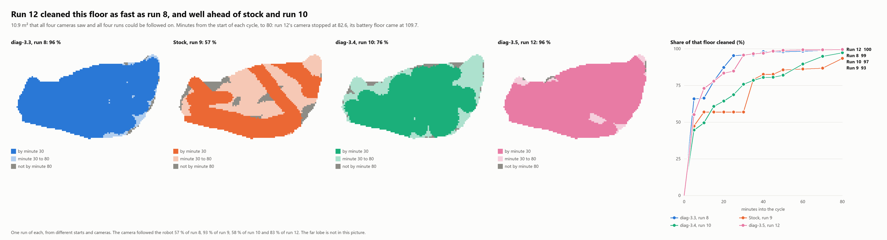
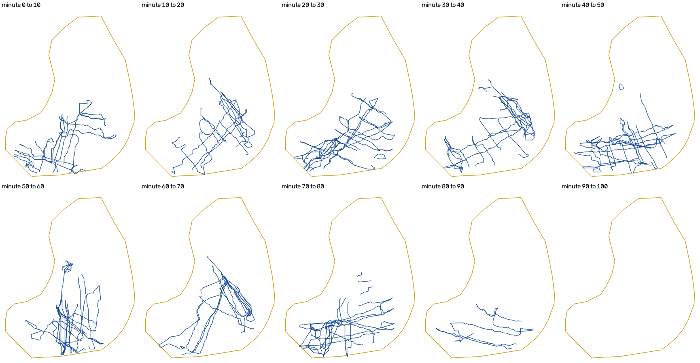

# Four optimized runs against stock, measured by video

Five filmed runs in the same pool: stock once, and the optimized program four times across three builds. **On the
10.7 m² that all five runs could be followed on, diag-3.5 cleaned 96 % by minute 30 and 99 % by minute 45. Stock
cleaned 58 % and 83 %.** diag-3.5 was started from the robot's button with no PC, and ran 109.7 minutes to its battery
floor, the longest run yet.

The raw video and the robot's logs are not published. The method is the one in the
[stock against optimized analysis](../stock-vs-optimized/analysis.md): `videotrack.py` finds the robot, and the robot's
own lanes calibrate each camera.

## The runs

| Run | Program | Started with | Minutes to the battery floor | Camera followed the robot |
|---|---|---|---|---|
| 8 | diag-3.3 | A PC | 88 | 58 % |
| 9 | Stock | The button | 92.8 | 93 % |
| 10 | diag-3.4 | The button | 89.7 | 58 % |
| 11 | diag-3.4 | The button | 45.7 | 88 % |
| 12 | diag-3.5 | The button | 109.7 | 83 % to minute 82.6 |

- **Run 11 was short because its battery was not full.** It read 75 % on the first lanes, against 90 to 100 % in runs 10
  and 12. It is compared only up to minute 45.
- **Run 12's camera stopped at minute 82.6,** so its last 27 minutes are not filmed.
- **diag-3.4 and diag-3.5 navigate the same way.** diag-3.5 changes only the battery floor, described below.

## The result

The 10.7 m² that all five cameras saw and all five runs could be followed on. Share ever cleaned, from the start of
each cycle:

| Minutes into the cycle | 5 | 10 | 15 | 20 | 25 | 30 | 35 | 40 | 45 |
|---|---|---|---|---|---|---|---|---|---|
| **Run 8, diag-3.3 (%)** | 66.1 | 66.6 | 77.9 | 87.4 | 95.6 | 96.0 | 96.2 | 98.2 | 98.2 |
| **Run 9, stock (%)** | 47.7 | 57.5 | 57.5 | 57.5 | 57.5 | 57.5 | 79.0 | 82.6 | 82.6 |
| **Run 10, diag-3.4 (%)** | 45.2 | 50.3 | 61.6 | 65.3 | 69.6 | 76.8 | 79.4 | 81.4 | 81.6 |
| **Run 11, diag-3.4 (%)** | 47.5 | 76.9 | 84.1 | 85.0 | 90.0 | 92.8 | 94.6 | 95.0 | 97.0 |
| **Run 12, diag-3.5 (%)** | 55.5 | 73.6 | 78.7 | 84.1 | 85.4 | 96.2 | 97.3 | 97.3 | 98.8 |

The 10.9 m² that the four long runs share, to minute 80:

| Minutes into the cycle | 30 | 40 | 50 | 60 | 70 | 80 |
|---|---|---|---|---|---|---|
| **Run 8, diag-3.3 (%)** | 95.7 | 98.0 | 98.0 | 98.3 | 98.8 | 99.1 |
| **Run 9, stock (%)** | 56.8 | 82.5 | 85.6 | 86.2 | 86.7 | 93.4 |
| **Run 10, diag-3.4 (%)** | 75.8 | 80.4 | 81.9 | 89.5 | 94.8 | 97.2 |
| **Run 12, diag-3.5 (%)** | 95.6 | 96.9 | 98.9 | 99.2 | 99.2 | 99.5 |

Against stock alone, on the 17.2 m² that run 12 could be followed on:

| Minute | 10 | 30 | 45 | 80 |
|---|---|---|---|---|
| Run 12, diag-3.5 (%) | 62.1 | 87.8 | 92.6 | 98.7 |
| Run 9, stock (%) | 58.2 | 62.3 | 81.7 | 89.9 |

- **Every optimized run is ahead of stock by minute 30.** The gap is 19 to 39 points on the five-run floor.
- **The optimized runs differ among themselves, 77 to 96 % at minute 30.** Runs 10, 11 and 12 ran the same pattern. The
  spread comes from cameras, starting points and chance, and three runs cannot tell those apart. Run 10's camera followed
  the robot only 58 % of the time, which pulls its numbers down.
- **The assumed water depth barely matters.** From 0.7 to 1.0 m it moves the comparison with stock by at most 0.9 points.

## No long stays

The outline is the waterline. The far lobe, at the top of each panel, is lost in the sky's reflection for this camera,
so an empty lobe there says nothing about where the robot went. The last two panels are empty because the camera had
stopped.

Floor touched and new floor gained in each ten minutes of run 12:

| Minutes | 0-10 | 10-20 | 20-30 | 30-40 | 40-50 | 50-60 | 60-70 | 70-80 | 80-82.6 |
|---|---|---|---|---|---|---|---|---|---|
| Floor touched (m²) | 10.5 | 10.7 | 12.3 | 11.6 | 11.7 | 11.0 | 10.7 | 11.7 | 6.7 |
| New floor (m²) | 10.7 | 2.7 | 1.7 | 0.6 | 0.4 | 0.5 | 0.4 | 0.1 | 0.0 |

Stock spent 40 of its 93 minutes on two small strips (see the
[stock against optimized analysis](../stock-vs-optimized/analysis.md)). The smallest area the robot stayed in for five
minutes:

| Run | Smallest area held for five minutes |
|---|---|
| Run 9, stock | 0.9 m² |
| Run 10, diag-3.4 | 2.5 m² |
| Run 12, diag-3.5 | 6.3 m² |
| Run 11, diag-3.4 | 7.4 m² |

After minute 30 the filmed floor is nearly all clean, and run 12 keeps going over it. Any gain from its longer run
would be in the part of the pool this camera does not see.

## diag-3.5: the battery floor waits a minute

The vendor's battery percentage is a step table on the cell voltage under load, so the reading moves with the load as
well as with the charge. The recorders caught three kinds of movement:

| What | Size | How long |
|---|---|---|
| Pump start at full power | 20 points | Seconds |
| One reading during a hard turn | 15 points, which tripped a 20 % floor from a steady 35 % | Under 13 s |
| Alternating with the step above | 5 points | 1.5 to 4.2 minutes per step |

Earlier builds tripped the floor on the first reading at or below it. diag-3.5 trips only after every reading for 60 s has
been at or below it. A reading above the floor, or an invalid one, starts the minute again. So a dip never ends a run,
and the trip comes within the alternation at the floor step, up to about four minutes later.

**Why run 12 lasted 109.7 minutes is not measured.** Runs 6 to 10 lasted 82.3 to 92.8. The minute rule explains a few
minutes, not 17. Earlier runs may have tripped early on a dip under load, as one did from a steady 35 %. That is likely,
but the recorder keeps only the start of a run, and nothing records the dips the minute rejected.

## How far to trust it

- **Run 12's camera fit is the strongest so far.** The video clock's offset came from the robot's own rhythm, with a
  correlation of 0.52 against 0.16 for the next best. The median error is 11 cm on 90 cm pieces, and 99 of 120 pieces
  fit.
- **The plans agree.** Run 12's plan lines up with stock's at a scale of 0.912 and 3.4° of rotation. The two floor drains
  agree to 3 and 10 cm, and two waterline marks to 15 and 16 cm.
- **Checked by eye.** In 11 close-ups inside the cycle, the robot was under the track in 10. The miss was in dark water
  under a waterfall.
- **Limits.** One run of each build, in one pool. Coverage assumes a 40 cm brush, which has not been measured. The far
  lobe is not compared.

## Next

1. Film the far lobe, with a second camera or a new position, for the first whole-pool comparison.
2. Film a whole run to its battery floor. That needs about two hours of recording.
3. Teach the simulator the long stays stock shows, so it can judge rules by itself.
4. Try a lane spacing nearer 30 to 35 cm, once the brush width is measured.
