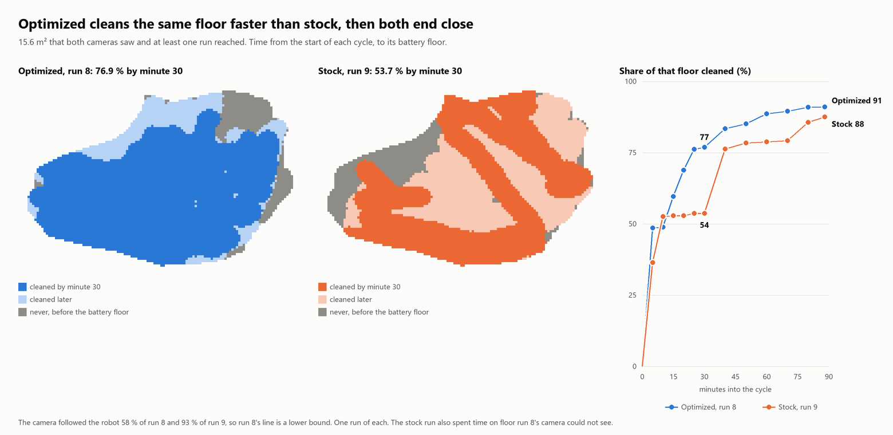
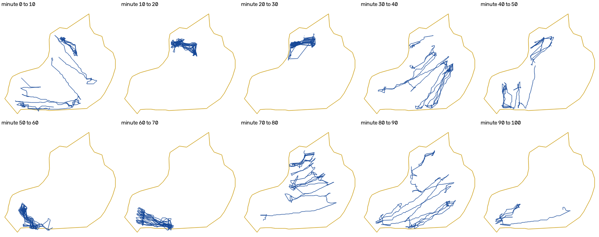
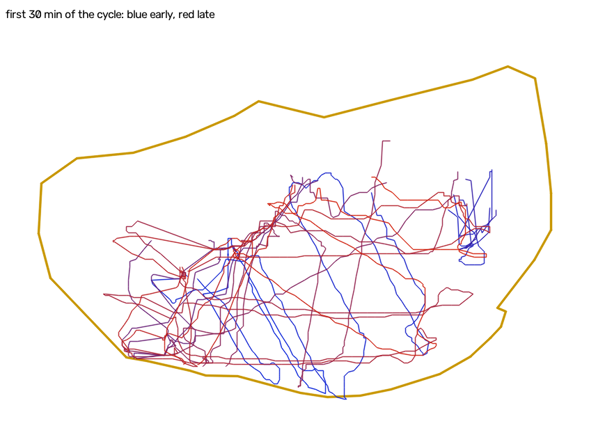
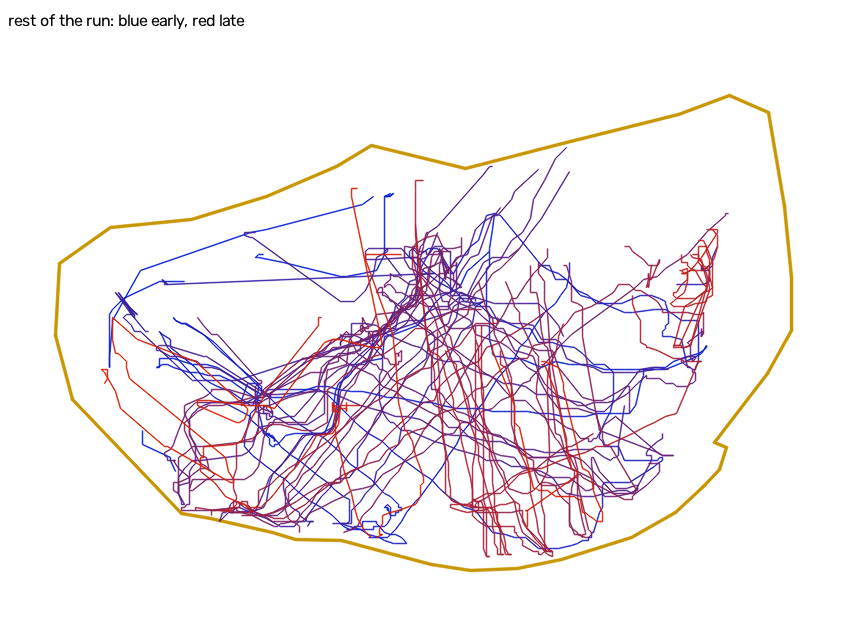

# Stock against optimized, measured by video

The stock Floor program and the optimized one, filmed in the same pool. **On the floor both cameras saw, optimized
reached 77 % by minute 30 and stock 54 %. They ended close, 91 % against 88 %. Stock spent 40 of its 93 minutes on two
small strips.** This is one run of each, so it is a first measurement and not a verdict.

Run 8 is the optimized program and run 9 is stock, both on the same robot. The raw video and the robot's logs are not
published. `video_track.py`, `video_study.py` and `video_figure.py` are here as a record of the method.

Run 9 was started from the robot's button, with no PC connection beforehand. So its recorder is empty and its starting
battery was not read. Its map and path log were downloaded afterwards, and they confirm the stock program ran.

## Timeline of run 9

| Cycle minute | Event |
|---|---|
| −0.5 | Power on |
| −0.2 | Lowered into the water |
| 0 | Cycle starts |
| 29.2 | Oldest piece the path log still holds |
| 92.8 | **Battery floor.** Inferred from the path log's change to drive 35 then 77, the same change seen at run 8's known trip. Stock does not report the time |
| About 93 | Pinned at the far wall, and there until the video ends |
| 99.8 | Video ends |
| 100.2 | Last map update |
| 106.2 | Read-out: same boot, no faults, no watchdog reset, battery 30 % |

## How far to trust the video

- **The camera moved between runs, and the second view is far better.** It is higher and steeper. It sees nearly the
  whole pool, but loses a strip along the near wall and whatever overhanging foliage hides. Waterline in view: 25.8 m².
- **The robot was followed 93 % of the time up to the floor, against 58 % in run 8.** Run 9 had one absence over a
  minute (2.4 min), against ten in run 8.
- **The robot calibrated the camera.** The lanes come from the path log: 130 pieces, heading from the gyro, length from
  time at 20.5 cm/s. That speed is the map's own sonar check over 256.9 m. The lens was held at run 8's values. The fit
  gives a median error of 10 cm on an 82 cm piece, and a free lens fit gave the same pose within about 1° and 0.15 m.
- **The two plans agree independently.** Three physical marks seen in both videos line up to within 8 cm, at a scale
  ratio of 0.976 and 3.7° of rotation, once waterline marks are pulled back for about 0.9 m of apparent depth. The two
  tracks also reach the same left, near and right limits.
- **The path log confirms the track.** Of 87 lanes with a track, 86 agree with the log's heading and length to within
  0.45 m, with a median error of 0.16 m. In the far lobe, where the robot is a small dark patch, 24 of 24 agree.
- **Checked by eye.** In 40 fresh random frames the robot was clearly visible in 19, and the track was on it in all 19.
  In 15 the track was in the far lobe, where one still shows at best a small dark patch and a sequence shows it moving.
  6 were gaps with no robot visible. In no frame was the robot visibly somewhere else.
- **Two false stretches were removed by hand.** A white plume across the water drew the tracker for 60 s near the
  start. After the battery floor the pinned robot fades into the background and only noise is left.
- **Limits.** The floor is treated as flat, and the far part of the view is coarser. Positions are good to perhaps 10 to
  20 cm near the camera and worse far away. Coverage assumes a 40 cm brush, which nobody has measured.

## The result: stock against optimized on the same floor

The floor is 15.6 m²: what both cameras had in view and at least one run reached. Share ever cleaned, from the start of
each cycle:

| Minutes into the cycle | 5 | 10 | 15 | 20 | 25 | 30 | 40 | 50 | 60 | 88 |
|---|---|---|---|---|---|---|---|---|---|---|
| **Run 8, optimized (%)** | 48.5 | 48.8 | 59.6 | 68.8 | 76.2 | 76.9 | 83.4 | 85.1 | 88.6 | 91.0 |
| **Run 9, stock (%)** | 36.4 | 52.6 | 52.9 | 52.9 | 53.7 | 53.7 | 76.3 | 78.4 | 78.8 | 87.5 |

- **Optimized gets there sooner.** 75 % took 23 minutes against 38. 90 % took 72 minutes, and stock never reached it
  before its battery floor. Stock led only at minute 10.
- **Run 8's line is a lower bound.** Its camera lost the robot 42 % of the time and run 9's 7 %, and part of this floor
  sat in run 8's glare.
- **The assumed depth does not change this.** From 0.7 to 1.0 m of apparent depth, run 8's minute 30 moves from 73.8 to
  77.3 and run 9's from 53.9 to 53.3.
- **This is not the whole pool.** Stock spent 20 of its minutes in the far lobe, which run 8's camera could not see. So
  nothing here says how optimized treats the far lobe.

## Finding 1: stock stays on two small strips for 40 of 93 minutes

Floor touched and new floor gained in each ten minutes:

| Minutes | 0-10 | 10-20 | 20-30 | 30-40 | 40-50 | 50-60 | 60-70 | 70-80 | 80-90 |
|---|---|---|---|---|---|---|---|---|---|
| Floor touched (m²) | 10.3 | 2.1 | 2.5 | 10.2 | 6.4 | 2.5 | 2.9 | 10.0 | 11.8 |
| New floor (m²) | 10.3 | 0.6 | 0.5 | 3.5 | 0.3 | 0.1 | 0.1 | 1.1 | 0.4 |

Minutes 10 to 30 are one strip in the far lobe, and minutes 50 to 70 one strip in the near-left corner. Those 40 minutes
gained 1.3 m² of new floor. The lanes there are about 1 m long. Optimized has the same trap, but its longest stay was 8
minutes. So the trap is not something the optimized controller brought in.

For comparison, the optimized path from run 8. Its camera saw less of the pool.

## Finding 2: how the two programs differ in the water

| | Stock, run 9 | Optimized, run 8 |
|---|---|---|
| Lane drive | 64 | 69 |
| Real lane speed | 20.5 cm/s (sonar over 256.9 m) | About 22 cm/s (sonar over 3.2 m) |
| Time moving, whole cycle | 43 % | 60 % |
| Lanes per minute, in the path log | 1.45 | 2.05 |
| Median lane, in the path log | 9.7 s | 14 s |
| Backing up, in the path log | 13 % | 6.5 % |
| Sideways distance between consecutive lanes | 0.22 m (0.01 to 0.66, 53 pairs) | 0.48 m (0 to 1.5, 13 pairs) |
| Angle between consecutive lanes | 12.7° | 6° |
| Passes per spot on the same floor | 11.3 | 14.1 |

- **The speed setting barely changes the real speed.** Stock's "30" and optimized's "23" differ by less than 2 cm/s on
  the floor. The optimized program gains by turning less and running longer lanes.
- **Stock's lanes overlap heavily, and optimized's leave slivers.** Neither is at the 30 to 35 cm that would suit a
  40 cm brush. Run 8's log figures come from its last 21 minutes only, and the two spacing samples used slightly
  different filters.

## Finding 3: the simulator is too optimistic, for stock as well

| Minute | 20 | 30 |
|---|---|---|
| Stock, simulated, whole pool (%) | 79.3 | 91.6 |
| Stock, measured, floor it ever reached, 17.6 m² (%) | 62.3 | 65.4 |
| Stock, measured, waterline outline, 25.8 m² (%) | 42.4 | 44.5 |

Measured against its own reach, stock passes 95 % just after minute 80, where the simulator says 35.8. The long stays in
Finding 1 are the difference, because the simulator has no such thing. It should learn to reproduce these stays before it
is used to choose a rule.

## Finding 4: the gyro drifted almost twice as fast

The drift was −4.52 °/min from the camera fit and −4.5 directly. The camera's lane direction minus the logged yaw climbs
steadily over 69 lanes, by 234° in an hour.

| Run | Cycle began after power-on | Gyro drift |
|---|---|---|
| 6 | 469 s | −2.04 °/min |
| 7 | 206 s | −2.34 °/min |
| 8 | 189 s | −2.45 °/min |
| 9 | 30 s | −4.52 °/min |

**The sooner the cycle starts after power-on, the larger the drift.** That is four runs, by more than one method, and
run 9 is the only stock run among them. So it is a lead and not a result. It suggests the gyro warming up or settling. A
start from the button looks like run 9, so it matters to anything that relies on the gyro over a cycle.

## Finding 5: at the battery floor, a pin at the wall and no return to the start

Within about 20 s of the floor the robot was against a wall, and it stayed there until the video ended 6.8 minutes later.
The path log shows drive 47 to 77 for 170 s of that, hardly turning. Run 8 did the same, so this is vendor behaviour too.

Run 9 ended about 4 m from where it went in, across the pool. Run 8 ended about 2 m along the same wall as it started. One
run each way fits the firmware having no return-to-start, and run 8's ending looks like chance.

## Could the battery floor go higher?

Probably to about 40 %, but not on this evidence alone. Two earlier optimized runs kept the end of the cycle in their
recorders, and they agree on how long before the trip the reading first reaches each level. Moving run 8's trip that much
earlier and reading its curve on the same floor gives:

| Floor | Run 8 would have stopped at minute | Same floor cleaned by then (%) |
|---|---|---|
| 20 %, today | 88 | 91.0 |
| 35 % | 82 to 83 | 91.0 |
| 40 % | 77 | 90.8 |
| 45 % | 70 to 73 | 89.5 to 90.1 |
| 50 % | 67 to 68 | 89.4 to 89.5 |
| 55 % | 61 to 64 | 89.4 |

- **The last half hour adds little on this floor:** 1.6 points after minute 61.
- **The margin over 90 % is under one point.** At the lowest assumed depth run 8 never reaches 90 % at all (89.8).
- **This is 15.6 m², not the pool.** If optimized reaches the far lobe late, a higher floor costs more than this table
  says.
- **The 20 % floor trips on a dip, not on 20 %.** The percentage is a step table on the cell voltage under load, so it sags
  with the motors. In one run the reading stayed at 35 % until one sample of 20 % during a hard turn. At rest afterwards
  it reads 25 to 35 %.
- **How much battery life this buys is not measured.** A shallower discharge is generally kinder to a lithium pack, but
  these percentages are not true state of charge. Stopping the push at the wall saves energy at no cost in cleaning, so
  that comes first: the robot drove for 5.7 to 29.7 minutes after the floor across these runs.

## Next

1. Make the optimized Floor run from the button or the app, with no PC.
2. End a side when lanes make no sideways progress, and teach the simulator these stays first.
3. Stop the map counting after the battery floor, and stop the push at the wall.
4. Try a lane spacing nearer 30 to 35 cm, once the brush width is measured.
5. Test the drift lead on the bench: read the gyro heading with the robot still, straight after power-on and a few
   minutes later.
6. Film the next build from the same camera position, for the first whole-pool comparison.
